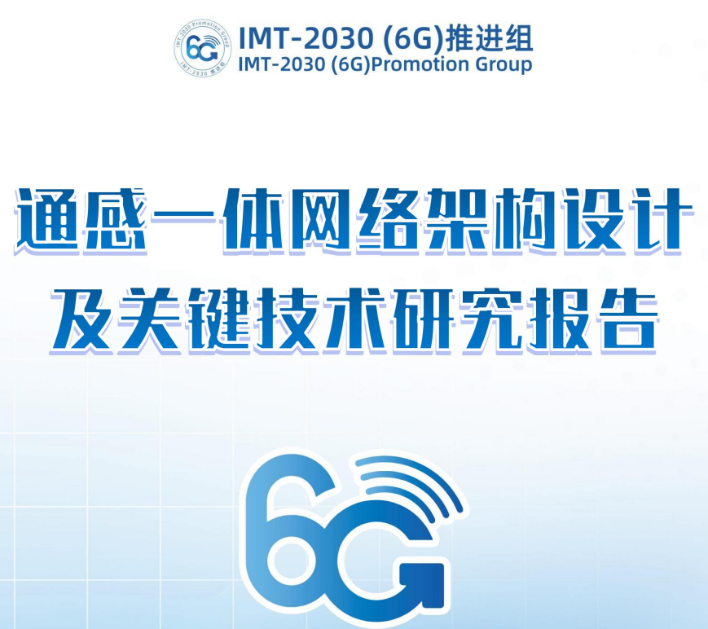
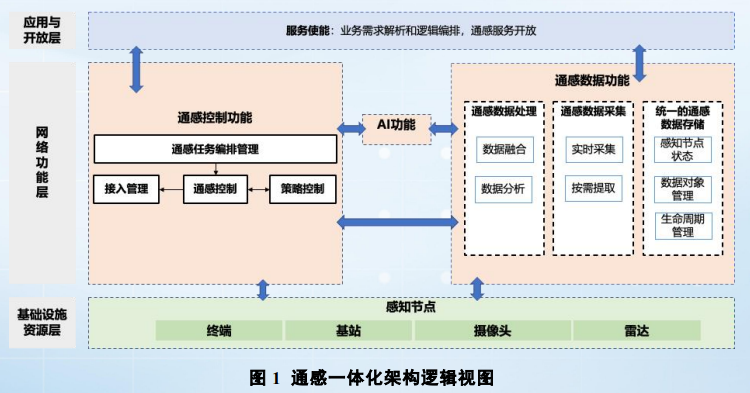
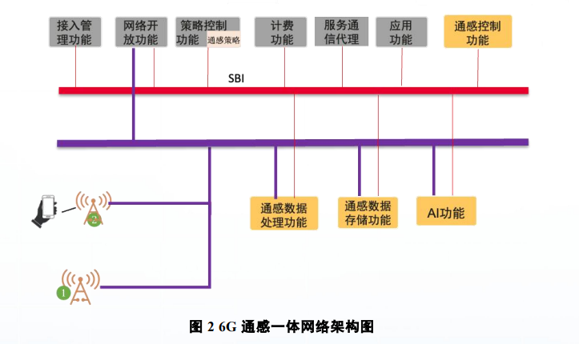

# 6G Core Features! Integrated Sensing Network, Embracing the New Era of Intelligent Perception for Everything

6G Core Features! Integrated Sensing Network, Embracing the New Era of Intelligent Perception in Everything 
At a critical stage of the evolution of mobile communication technology towards 6G, the integration of sensing and perception has become a key characteristic defining the core capabilities of the next-generation network. From comprehensive traffic situation perception across smart transportation to contactless vital sign detection in health monitoring, and to precise mapping of the physical world through digital twins, integrated sensing technology transforms mobile communication networks from mere "pipes" for information transmission into "smart nerves" that perceive the physical world, connecting virtual and realities. 
In November 2024, the IMT-2030 (6G) Promotion Group released the "Integrated Sensing Network Architecture Design and Key Technologies Research Report," systematically elucidating the architecture design, core technologies, and application prospects of 6G integrated sensing. This report provides direction for the industrialization of this core 6G technology. Today, let's unlock the core content of this report and see how integrated sensing is reshaping the future information service system. 
Why Integrated Sensing? A Must-Choose for the 6G Era If 5G achieved "interconnectivity" for everything, then the goal of 6G is "intelligent interconnectivity." Integrated sensing is the core approach to achieving this goal. Compared to the exploration of sensing in the 5G era, the core feature of 6G integrated sensing lies in multidimensional perception and multi-node collaboration, enabling efficient processing of various sensing data to achieve precise identification and analysis of physical environments and target detections, and ensuring secure openness of sensing results based on network strategies. 
The driving force behind its development comes from both practical business needs across various industries and intrinsic technological innovation.
From a business perspective, emerging scenarios such as intelligent transportation, smart factories, low-altitude economy, health monitoring, and environmental restructuring demand the ubiquity and high precision of network perception. For instance, in intelligent transportation, a unified sensory system can perceive vehicle and pedestrian statuses from a "God's eye view," achieving real-time identification and warning for emergencies; in health monitoring, it can monitor human breathing frequency without contact through signal interaction between base stations and terminals. Additionally, diverse data types, extreme real-time and low-latency requirements, flexible network deployment demands, and data privacy security protection all have led to the development of new unified sensory network architecture designs.
Technology-driven integration has made the implementation of omnisensation possible. On one hand, the development of the metaverse and digital twins requires efficient collection of multidimensional information from the physical world to provide data support for the real-representation of virtual scenarios and real-time monitoring of physical objects. On the other hand, artificial intelligence becomes a "catalyst" for omnisensation, not only capable of efficiently mining and analyzing massive complex perceptual data to enhance perception accuracy and resolution but also adaptive optimization of system parameters, ensuring stable operation of omnisensation technology in complex environments.
How to construct? The core design of the integrated sensory network architecture is to support the complex and diverse business needs of the 6G era. The report proposes a flexible, intelligent, and scalable integrated sensory network architecture, clarifies the architectural design principles and overall design scheme, allowing for the deep integration of communication and perception capabilities.
Four major design principles, solidifying the foundation of architecture. Architecture design adheres to four logical principles: cross-scenario, distributed, compatibility, and security. At the same time, around the reuse of communication system facilities, a core function design is clarified:
1  
Cross-scenario: Supporting single/multiple base station, single/multiple terminal perception and other scenarios, taking into account the associated data processing of the moving target across base stations.
2  
Distributed: Perception, communication, and computing functions can be distributed across multiple nodes, balancing the convenience of centralized management with the high reliability of distributed deployment.
3  
Compatibility: Implementing smooth upgrades of new capabilities through the service-oriented architecture, interfaces, and protocols of existing core networks, access networks.
4  
Security: Ensure the confidentiality and integrity of sensed data, establish a sensed business authorization mechanism, and protect the privacy information of sensed targets.
In terms of functionality, the 6G integrated tactile-sensory architecture integrates four core functions: perception control, data processing, data storage, and signal transmission. It supports six basic perception modes including autonomous generation and reception by base stations and terminals receiving signals from base stations. It can transmit three levels of sensory information: raw channel data, perception measurement values, and perception results, meeting the requirements for sensory precision in different scenarios.
A three-tier overall architecture, realizing the integration of full process capabilities. The architecture is logically divided into application and open layer, network function layer, infrastructure resource layer. Each layer collaborates to achieve a full process service from perceiving needs to perceiving results:
★  
Application and Open Layer: Responsible for business requirement analysis, sensory service openness, and providing standardized perception services to third parties.
★  
Network Function Layer: Core layer, which includes three major functions of Tongxin Control, Tongxin Data and AI, to achieve the task of perception arrangement, data collection and processing, intelligent analysis and optimization.
★  
Infrastructure Resource Layer: Composed of base stations, terminals, cameras, radars and other perception nodes, it is the physical foundation for receiving and transmitting perception signals and collecting data.
At the same time, the architecture has also designed multiple standardized interfaces for control and data planes, achieving efficient interaction between various functional network elements and sensing nodes. It takes into account the integration access of 3GPP and non-3GPP sensing data, making the entire network an organic whole.
Core Technology Breakthroughs, Bridging the Key Link in Integrated Perception and Sensing Implementation
Multi-source perception data reporting, achieving comprehensive data collection and perception. The sources of data include terminals, base stations, and non-3GPP devices, forming a comprehensive data collection system: Terminals can undertake perception detection and data reporting capabilities, while anonymous reporting and fuzzy processing protect privacy; Base stations support multi-node collaborative reporting, requiring time synchronization to ensure data processing accuracy; Non-3GPP devices (such as WIFI, Bluetooth, sensors) serve as auxiliary data sources, achieve collaborative perception with 3GPP data through integrated access functions, enhancing measurement accuracy and comprehensiveness.
Efficient perception data transmission, adapting to the massive data needs of 6G. For the multi-point to multi-point transmission needs of 6G perception data, this study breaks through the 5G synchronous P2P direct connection transmission model, proposing multiple transmission schemes: including user-facing transmission, data collection services provided by data storage functions, and innovatively introducing the new logic function of transduction data transmission channels. By decoupling data producers and consumers, achieving asynchronous data exchange, significantly improving transmission efficiency, and adapting to various transmission scenarios between RAN-RAN, RAN-CN, and CN-CN.
Collaborative data processing and reuse, enhancing resource utilization efficiency. Perception data processing is no longer solely carried out by the core network, but terminals, base stations, and non-3GPP devices can participate in collaborative processing based on their computing capabilities, reducing network computing burden; At the same time, through perception data reuse technology, identifying reusable data in multiple tasks, eliminating the need for repeated collection requirements, adopting a publish-subscribe mechanism to enable data sharing among multiple consumers, significantly improving data transmission and storage efficiency, maximizing the value of perception data.
Full process control of perception tasks, ensuring stable and secure business operations. From selecting perception nodes, ensuring business continuity, to authentication authorization, incentive mechanisms, and billing systems, a full process control system for perception tasks has been established:
★  
Perception node selection takes into account factors such as node capabilities, location, and environment, supporting multi-node collaboration and Sidelink technology assistance to ensure perception accuracy;
★  
By switching perception nodes and perception modes (such as single mode to mixed mode), ensuring that perception services are not interrupted;
★  
Establish a dual authentication authorization mechanism, which not only verifies the qualification of the business requester but also obtains permission for the target object, protecting privacy and network security.
★  
★  
Establish a third-party billing system that supports various methods of billing, such as call counts, traffic, and duration, to realize the value transformation of perceptual data.
Perception and AI are deeply integrated, empowering intelligent perception upgrades. AI is the core enabling technology for holistic perception integration. Targeting the multi-dimensional, multi-granularity, and multi-node collaboration characteristics of 6G perception data, AI can achieve data format normalization, processing precision enhancement, and assist in the selection of perception nodes, realizing fuzzy recognition of perception data and object identity recognition. It can even scientifically formulate perception strategies, achieving a qualitative leap in the intelligence level of the entire perception system.
Future Outlook: Integrated Sensing for 6G, Embarking on a New Era of Intelligent Connectivity for Everything
In the future, haptic integration technology will be deeply integrated into various industries: in the field of intelligent transportation, it realizes full-domain unobstructed road condition perception and autonomous driving collaboration. In the field of smart cities, construct a city-level intelligent perception network to achieve precise control of environmental monitoring and public safety. In the field of industrial manufacturing, provide real-time device status and process production perception data for digital twin factories. In the field of people's livelihood services, achieve contactless health monitoring and smart home scenario-based perception...
Integrated perception, enabling 6G networks to not only "transmit information" but also "know the world." As a core feature of 6G, it will propel mobile communication from an information transmission service to an all-lifecycle information service, forging the longboard of information and communication networks. It injects new momentum into the development of the digital economy, truly ushering in a new era of intelligent perception of everything.

## Images

<!-- PAYMENT_BLOCK -->

## Get this dataset

- Payment link (Stripe): [Buy now](https://buy.stripe.com/3cs8yP7sY87d0vu9AB)
- Payment QR code: 

<!-- /PAYMENT_BLOCK -->
